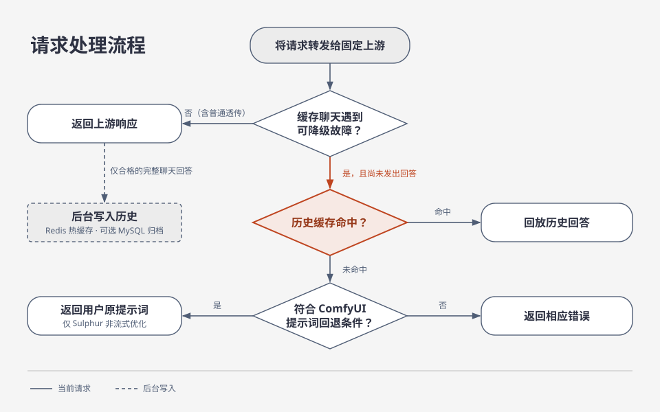

# RecallRelay · Rust 版

RecallRelay 提供一个 HTTP 入口，普通 API 请求转发到固定上游。启用聊天缓存后，`POST /v1/chat/completions` 仍先访问上游，成功时转发 JSON 或 SSE，并在回答符合条件时保存副本。只有遇到可降级的上游故障，才会读取历史。

普通 HTTP 透传保留请求方法、原始路径和查询串、端到端请求头及正文字节。配置的聊天和模型列表路径可以映射到上游路径。`Host`、`Connection` 等连接级信息由 Relay 为下一跳处理。Compose 默认配置了 Redis，启用聊天缓存；本地直接运行时，留空 `REDIS_URL` 即可只用透传。



用 Compose 可直接启动 Relay、Redis 和 MySQL，默认入口为 `http://127.0.0.1:8000`。

```sh
sh deploy/compose/init-env.sh
docker compose up -d --build --wait relay
docker compose logs --tail 100 -f relay
```

## 先跑通一个请求

在本项目目录打开终端。本机编译需要 Rust、CMake、C++ 编译器和 libclang，第一次会下载 Cargo 依赖。用 Docker Compose 时，镜像内已经配置好编译工具。下面用项目附带的模拟模型，示例令牌 `demo` 只用于这次本地练习。

**终端一** 启动模拟上游。它监听 8091，扮演部署时的模型服务。

```sh
MOCK_UPSTREAM_API_KEY=demo cargo run --locked --example mock_upstream
```

**终端二** 启动 RecallRelay。这是客户端连接的服务，监听 8000。

```sh
UPSTREAM_URL=http://127.0.0.1:8091/v1/chat/completions cargo run --locked
```

**终端三** 发一次请求。响应的 `choices[0].message.content` 应为 `Mock response from demo-model.`。

```sh
curl -sS http://127.0.0.1:8000/v1/chat/completions \
  -H 'Authorization: Bearer demo' \
  -H 'Content-Type: application/json' \
  -d '{"model":"demo-model","messages":[{"role":"user","content":"你好"}]}'
```

用 RustRover 打开本项目时，可以直接在它的终端里运行以上命令。调试时在 `dispatch` 打断点，再发送一次请求，就能看到请求路径和请求头。

## 同一个 POST 怎样返回 JSON 或 SSE

聊天客户端发送的都是 `POST /v1/chat/completions`。上面的请求省略了 `stream`，模拟服务一次返回完整 JSON。想看 SSE，在同一条命令的请求体中加上 `"stream":true`，将 curl 的 `-sS` 改为 `-NsS`，终端就会按收到的顺序打印 `data:` 事件。

启用历史后的聊天处理器会检查 `User-Agent`。以 `ComfyUI-Sulphur-Prompt-Enhancer/` 开头的标识可识别 Sulphur 插件。提示词回显还要求是非流式、单回答的文本优化请求，并且前面的降级阶段均未得到结果。插件内部的语言和风格探针按其自己的规则处理。

### 在容器日志里跟一次请求

```sh
docker compose logs --tail 100 -f relay
```

每次请求会得到一个 `request_id`。同一个 ID 下可以看到请求正文、上游主机与路径、返回状态和响应正文。JSON 直接预览，SSE 收到完整的行就输出；每个方向最多预览前 2048 字节，`omitted_bytes` 表示省略的字节数。长图片的 Base64 会缩略；图片排在提问前面时，聊天日志会另显示最多 256 字节的用户文字。二进制和压缩正文只记录长度。将 `RELAY_LOG_CONTENT=false` 写入环境文件并重建 Relay 容器，可以只看转发和降级过程。

`relay_cache queued=true` 表示后台队列已接收回答。队列满时，Relay 先把正文交给客户端，在结束 HTTP 响应前等一个写入空位。Redis 写入和 MySQL 提交发生在后台。主模型调用失败时，`stage="primary"` 会记录原因；收到上游状态码时还会记录 `upstream_status`。缓存命中后，`relay_history` 会记录来源，响应带有 `X-Failover-Source: history`。符合条件的 Sulphur 提示词回显则标记为 `prompt`。

## 在相同地址验证故障回放

准备一个可访问的 Redis。假设它监听本机 6379，在终端二按 Ctrl+C 停止 Relay，然后用以下配置重新启动。客户端 URL 和请求体保持一致。

```sh
UPSTREAM_URL=http://127.0.0.1:8091/v1/chat/completions \
REDIS_URL=redis://127.0.0.1:6379/0 \
POLICY_EPOCH=demo-v1 \
cargo run --locked
```

先在终端三重新发送上面的正常请求，等回答收完。Relay 会在后台保存通过校验的回答。然后添加模拟服务识别的故障标记，再发同一个请求。

```sh
curl -si http://127.0.0.1:8000/v1/chat/completions \
  -H 'Authorization: Bearer demo' \
  -H 'Content-Type: application/json' \
  -H 'X-Request-ID: mock-outage-all' \
  -d '{"model":"demo-model","messages":[{"role":"user","content":"你好"}]}'
```

模拟上游这次返回 503。历史记录就绪后，客户端会看到 `200 OK` 和 `X-Failover-Source: history`。请求 ID 可以变化，授权信息、业务请求头、路径、查询参数和聊天参数都参与历史隔离。

## 沿着一次请求读代码

| 顺序 | 打开文件 | 读代码时可以观察什么 |
| --- | --- | --- |
| 1 | [src/main.rs](src/main.rs) | 找到唯一的 `TcpListener::bind`。看 `.await` 如何等待服务，以及 `?` 如何将启动错误交回调用者。 |
| 2 | [src/lib.rs](src/lib.rs) | 从 `dispatch` 读起。健康检查就地返回，启用历史的聊天请求交给聊天处理器，普通请求交给转发器。 |
| 3 | [src/passthrough.rs](src/passthrough.rs) | 在 `forward` 里跟着一条请求看 method、原始路径、查询串、请求头和字节如何发往固定主机。 |
| 4 | [src/relay/mod.rs](src/relay/mod.rs) | `handle` 负责解析请求，`conversation` 先请求上游，遇到可降级的故障才查缓存。 |
| 5 | [src/history/identity.rs](src/history/identity.rs) 与 [src/history/mod.rs](src/history/mod.rs) | `canonicalize` 借用请求，生成用于查找记录的指纹。`enqueue_wait` 等待后台队列接收完整回答，`lookup` 负责在上游故障时取回。 |
| 6 | [src/relay/sse.rs](src/relay/sse.rs) 与 [src/delivery.rs](src/delivery.rs) | 观察上游分块、SSE 事件和下游写入之间的区别。一个事件可能横跨多个网络分块。 |

第一次读可以只走前三步。遇到 `Arc::clone`，看它包住的是哪个共享对象，例如上游连接池。Relay 发出响应头后，SSE 还可能持续输出；跟着转发任务可以看到流如何在结束、超时或断开时释放上游连接。

## 聊天请求的处理顺序

每次先请求客户端指定的主模型。历史记录按凭据和请求范围隔离，只有带单个非空 `Authorization`、可确定身份的请求才参与读写。缓存只保存通过校验的完整上游回答。

后台按入队顺序写入回答，MySQL 会把已排队的多条回答合并提交。可选的向量索引在另一条队列上生成。向量计算繁忙时可能跳过索引，已经保存的完整回答仍可精确回放。

上游失败、精确缓存未命中且找到向量候选时，开启 `replay` 的请求会按到达推理槽的顺序排队。轮到该请求后才开始计算单次推理的超时。排队和推理共用本次请求剩余的总时间，SSE 使用启动阶段的剩余时间。普通请求仍直接并发转发上游，精确缓存命中也能立即返回。

上游超时、限流、服务故障或返回原因未知的错误（包括 HTTP 400、422）时，Relay 在向客户端发送回答前查询缓存。即使 HTTP 状态是 200，JSON 正文或 SSE 首个事件中出现的上游错误也按相同规则处理。遇到明确的鉴权失败、权限不足、内容政策拒绝或模型不存在时，Relay 直接转发上游响应。

| 来源 | 条件与行为 |
| --- | --- |
| 精确历史 | 先查 Redis，再查可选的 MySQL。回放前再次校验保存的 JSON 或 SSE。 |
| 近似历史 | 单张内联图片可按相同范围和已识别的意图匹配。启用向量后，由 Rust 进程内的 EmbeddingGemma 生成提问向量，按配置阈值匹配。 |
| Sulphur 提示词 | 缓存未命中时，符合条件的 ComfyUI Sulphur 非流式优化请求可返回用户原提示词，标记为 `prompt`。 |

普通聊天命中缓存时返回历史回答，并带 `X-Failover-Source: history`。未命中时返回相应的错误。SSE 已开始传输后，上游中断会终止当前响应。

### 哪些成功回答可以回放

- **回答类型和大小。** 历史只接收可识别请求下、通过校验的完整单回答。工具调用、拒答和不完整的流会跳过入库。每条记录上限为 256 KiB。SSE 按原始事件字节累计，超过上限后仍继续转发。聊天处理器对一次性读取的非流式上游正文另有 2 MiB 上限。
- **SSE 客户端的关闭时机。** 客户端收到 `[DONE]` 后可以关闭连接。对于可缓存的回答，Relay 会在剩余的流时限内继续等上游 HTTP 正文结束，最多再等一个流空闲时限。完整校验通过后才入队。终止事件交付之前断开、尾部出现错误或残帧、等待超时，都会跳过缓存。
- **存储故障。** 成功返回给客户端的回答可能仍在内存队列中。Redis 或 MySQL 写入失败会影响后续回放，MySQL 失败的批次不会自动补写。可以用上面的模拟故障例子同时核对回放响应头和正文。

## 常用配置

| 变量 | 用途 |
| --- | --- |
| `UPSTREAM_URL` | 完整聊天端点。普通请求沿用这个主机。也兼容只提供 `UPSTREAM_ORIGIN` 的配置。 |
| `RELAY_BIND` | 唯一监听地址，默认 `127.0.0.1:8000`。反向代理后的外部入口可另用 `INGRESS_ORIGIN` 声明，以检查转发环路。 |
| `REDIS_URL`、`REDIS_PREFIX`、`POLICY_EPOCH` | Redis 地址、历史命名空间和策略版本。与 Python 版共享既有记录时，使用原部署的前缀和策略值。 |
| `REQUEST_PATH` | 对客户端提供的聊天路径，默认 `/v1/chat/completions`。健康检查为 `/healthz`。上游使用标准聊天路径后缀时，可通过 `GET /v1/models` 查询对应模型列表。 |
| `MAX_BODY_BYTES` | 单个请求体的大小上限，默认 10 MiB，聊天和通用透传均适用。 |
| `TOTAL_TIMEOUT_SECONDS`、`STREAM_TIMEOUT_SECONDS` | 默认请求总预算 60 秒。启用历史后，已经提交的聊天流有独立预算，默认 600 秒。非流式、SSE 启动和 Sulphur 的细分预算见 [src/config.rs](src/config.rs)。 |
| `MYSQL_HOST`、`MYSQL_PORT`、`MYSQL_USER`、`MYSQL_PASSWORD`、`MYSQL_DATABASE` | 配置长期存储。Redis 热缓存默认保留 24 小时、最多 1024 条。MySQL 命中后会回填 Redis。 |
| `HISTORY_NEAR_MODE`、`HISTORY_EMBEDDING_MODE` | 可选 `off`、`shadow` 或 `replay`。`shadow` 只观察近似命中。默认启用规则匹配，关闭嵌入。 |
| `HISTORY_EMBEDDING_TIMEOUT_SECONDS` | 单条在线向量推理的时限，默认 0.65 秒，从取得推理槽开始计时。 |
| `HISTORY_EMBEDDING_MODEL_PATH` | 留空使用模型目录内的默认权重。Compose 启用向量时会复用卷内通过校验的模型，缺少或损坏则自动下载。也可指定自备 GGUF 文件在容器内的路径。 |
| `RELAY_LOG_CONTENT` | 默认 `true`，在容器标准输出预览实际请求和响应。正文内的业务数据也会出现在预览中。 |
| `RUST_LOG` | 例如 `recall_relay=debug` 可以查看降级阶段及命中计数。 |

## 验证与部署

本地用模拟上游验证过以下场景。下表记录测试条件，生产吞吐还取决于真实上游和请求大小。

| 场景 | 验证结果 |
| --- | --- |
| 普通 HTTP 透传 | 检查原始路径及查询串、凭据转发、重复的 `Set-Cookie` 响应头、二进制正文及请求大小限制。 |
| SSE 正常转发 | Relay 配额 2 vCPU、2 GiB。256 条流全部收到首帧后，同时保持 60 秒，每条约 3.0 kB/s。256/256 完整收到 `[DONE]`，每条流的业务分块数、内容和顺序与上游一致。 |
| 精确回放 | 16 并发写入 512 条不同的聊天回答，JSON 和 SSE 各半。待热缓存可读后，让上游返回 503，512/512 返回各自原来的正文及 `X-Failover-Source: history`。 |
| SSE 在终止标记后关闭 | 客户端收到 `[DONE]` 即断开，上游稍后正常结束，下一次故障请求能精确回放。对照用例验证了提前断开、尾随错误和不完整尾帧都会跳过入库。 |
| 向量回放 | 单核、真实 EmbeddingGemma，预先写入同范围的图片问答。128 个可命中的请求同时到达，128/128 正确回放，P95 约 6.05 秒。 |

单节点升级时，如果需要让已有 SSE 全部完成，先从反向代理摘除旧实例的新流量，等在途请求结束后再替换。Compose 默认给 Relay 75 秒退出，已开始的 SSE 默认最长可持续 600 秒。直接重建容器可能截断仍在发送的长回答。

```sh
cargo test --locked --all-targets
cargo clippy --locked --all-targets -- -D warnings
cargo fmt --all -- --check
```

默认测试使用本机临时端口和模拟上游。若要覆盖 MySQL、真实向量模型和突发回放，先准备独立的 MySQL 8.4 测试库、`redis-server` 和受支持的 GGUF，再执行 `cargo test --locked --all-targets -- --include-ignored`。可用 `TEST_REDIS_BIN` 指定 Redis 程序、`HISTORY_EMBEDDING_MODEL_PATH` 指定权重。测试数据库的环境变量见 [src/archive.rs](src/archive.rs)。

主 Compose 默认启动 Relay、Redis 和 MySQL。模型卷挂载和部署命令见 [Compose 说明](deploy/compose/README.md) 和 [Kubernetes 说明](deploy/k8s/README.md)。
